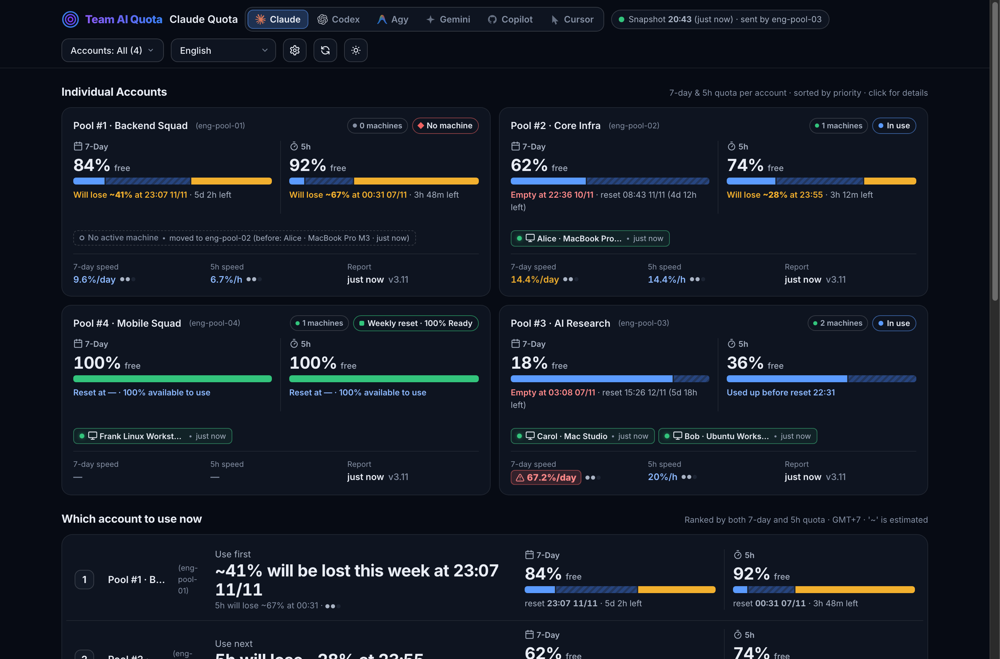
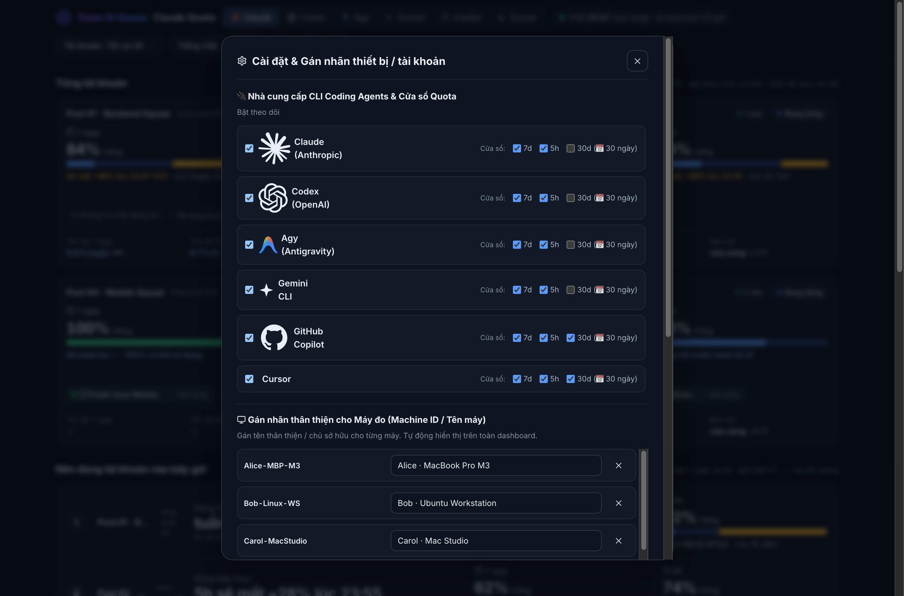
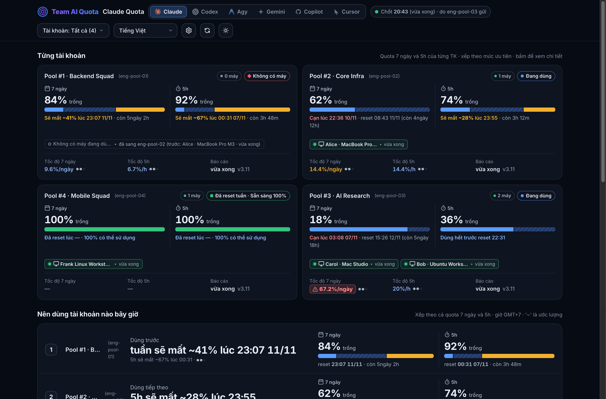
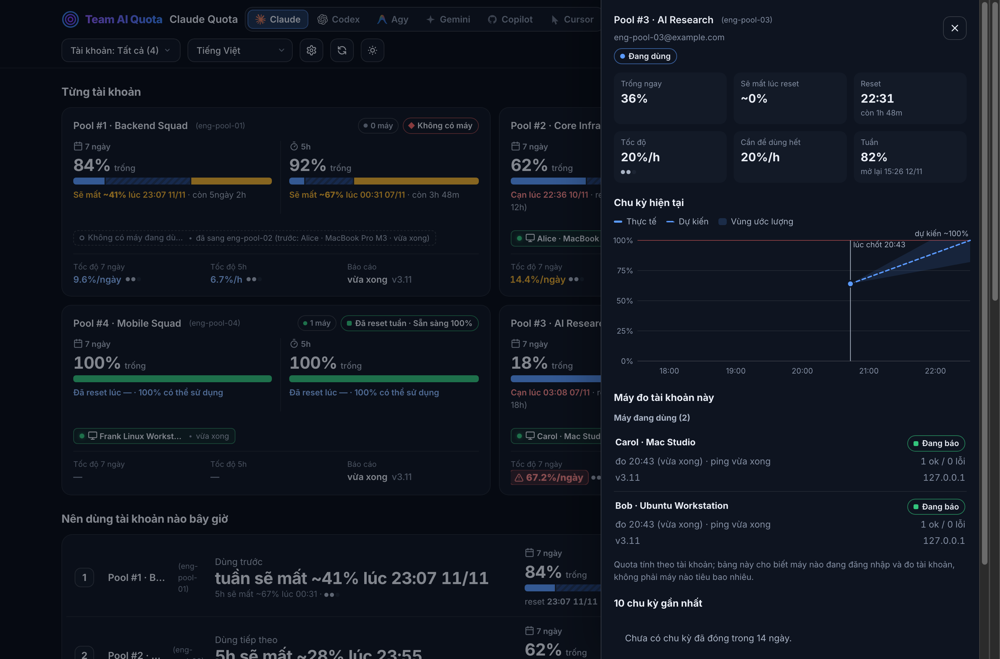

# Team AI Quota

[](https://github.com/braitoli/team-ai-quota/actions/workflows/ci.yml)
[](https://github.com/braitoli/team-ai-quota/pkgs/container/team-ai-quota)
[](LICENSE)
[](https://github.com/braitoli/team-ai-quota/releases/tag/v1.0.0)

> 🇻🇳 [Đọc bằng tiếng Việt](README.vi.md) · 🎬 **[Live demo (sample data)](https://braitoli.github.io/team-ai-quota/)**

> Smart AI coding quota management, load balancing & capacity planning for engineering teams.

---

## Why teams need this (not for individuals)

Individual quota monitors and local status bar extensions only observe a single developer on a single workstation. When engineering teams and enterprises scale their adoption of AI coding subscriptions (Claude Code Max/Pro, OpenAI Codex, Antigravity, Gemini CLI, GitHub Copilot, Cursor Agent), engineering leadership faces three critical operational dilemmas:

### 1. Bottleneck vs. Wasted Capacity
* **Mid-Sprint Lockouts (Bottlenecks)**: High-velocity developers exhaust their 5-hour rolling limit or 7-day weekly quota during critical release pushes. Their workflow grinds to a complete halt, even while other subscriptions assigned across the team sit 80–100% idle.
* **Sunk Costs & Expired Headroom (Wasted Capacity)**: At the end of every 7-day or 30-day window, underutilized accounts silently reset to 0% with 60–90% remaining quota unspent—wasting thousands of dollars in recurring monthly enterprise subscription fees.

### 2. Seat Collisions & Accelerated Burn
* **Concurrent Contention**: Multiple engineers inadvertently execute coding tasks against the exact same subscription simultaneously.
* **Hot Burn Spike**: Concurrent requests cause the burn rate (`%/h`) to spike exponentially, triggering sudden rate limits and locking out all collaborators within minutes.

### 3. The Team Solution: Coordinated Routing, Governance & Capacity Planning
* **Intelligent Real-Time Load Balancing**: Instant recommendation (`GET /api/route` or `ai_quota.py pick`) directs developers or automated CI jobs to the healthiest account using multi-factor priority scoring (`7-Day Headroom > 5-Hour Headroom > Sustainable Burn Rate`).
* **Predictive Capacity Planning**: Tracks actual consumption velocity (`%/h`) against safe sustainable velocity (`0.6%/h` for 7d, `20%/h` for 5h), flagging `Projected Exhaustion` before lockouts occur and identifying expiring surplus for optimal seat sizing.
* **Device & Member Governance**: Human-friendly workstation and account labeling directly in the Web UI (`⚙️`), automated seat collision detection, machine handoff history, and automatic transitions to **`Ready 100%`** the moment an account passes its weekly reset milestone.
* **Unified Fleet Telemetry**: Centralized visibility across heterogeneous CLI agents (`Claude Code`, `Codex`, `Antigravity`, `Gemini`, `Copilot`, `Cursor`) in a single pane of glass.

---

## Screenshots


*Figure 1: Full Web Dashboard Overview (English) — Highlighting the Hero Recommendation Card ("Which account should I use right now?"), multi-window capacity planning (7-day weekly priority & 5-hour rolling burst), and live account states (Ready, Active, Hot Burn & Collision, Weekly Reset Ready).*

<br/>


*Figure 2: Settings & Friendly Labeling Modal (`⚙️`) — Independent toggles for 6 CLI coding agents (`claude`, `codex`, `agy`, `gemini`, `copilot`, `cursor`), multi-window selection (`7d`, `5h`, `30d`), priority mode routing, and human-friendly machine/account name mappings.*

<br/>


*Figure 3: Internationalized Dashboard (Vietnamese View) — Real-time 7-day exhaustion alerts, sustainable burn pacing (`0.4%/h`), and automatic post-weekly reset recovery (`Đã reset tuần · Sẵn sàng 100%`).*

<br/>


*Figure 4: Workstation Telemetry & Burn Rate Drawer — Detailed consumption velocity curves, concurrent seat collision warnings, and workstation handoff audit trail.*

---

## Quick Start (Recommended: Docker)

The fastest and most reliable way to run Team AI Quota is via our official multi-arch Docker image published on GitHub Container Registry:

```bash
docker run -d \
  --name team-ai-quota \
  -p 8787:8787 \
  -v ~/.team-ai-quota/data:/data \
  -e QUOTA_AUTH_KEY=your-secret-key \
  ghcr.io/braitoli/team-ai-quota:latest
```

Verify service availability:

```bash
# Check service health
curl -s http://localhost:8787/health
# {"status":"ok","service":"team-ai-quota"}

# Open the Web Dashboard in your browser:
# http://localhost:8787/?key=your-secret-key
```

---

## Supported CLI Agents

Team AI Quota provides native collectors for all major developer CLI coding tools:

| Provider | CLI Tool | Quota Windows | Client Script | Description |
|---|---|---|---|---|
| **Anthropic Claude Code** | `claude` | `7d`, `5h` | `report_quota.py` | Zero-token regex parser inspecting `claude -p "/usage"` |
| **OpenAI Codex CLI** | `codex` | `7d`, `5h` | `report_codex.py` | Communicates with local `codex app-server` via stdio JSON-RPC |
| **Google DeepMind Antigravity** | `agy` | `7d`, `5h` | `report_agy.py` | Local quota & rate limit inspector for Antigravity sessions |
| **Google Gemini CLI** | `gemini` | `7d`, `5h` | `report_gemini.py` | Zero-token status and telemetry inspector for Gemini CLI |
| **GitHub Copilot CLI** | `gh copilot` | `30d`, `7d`, `5h` | `report_copilot.py` | Tracks monthly premium requests allowance & billing window |
| **Cursor Agent CLI** | `cursor` | `30d`, `7d`, `5h` | `report_cursor.py` | Parses local state & fast request quota from Cursor CLI |

---

## Deployment

### 1. Docker Compose (Recommended for teams)

Create a `docker-compose.yml` file on your host:

```yaml
services:
  team-ai-quota:
    image: ghcr.io/braitoli/team-ai-quota:latest
    container_name: team-ai-quota
    restart: unless-stopped
    ports:
      - "8787:8787"
    volumes:
      - quota_data:/data
    environment:
      - QUOTA_AUTH_KEY=replace-with-your-secure-secret-key
      - PORT=8787
      - DATA_DIR=/data
      - ENABLED_PROVIDERS=claude,codex,agy,gemini,copilot,cursor
      - MACHINE_LABELS={"a1b2c3":"MacBook-M3","d4e5f6":"Build-Server"}
      - ACCOUNT_LABELS={"dev1@example.com":"Lead Account"}
    healthcheck:
      test: ["CMD", "wget", "--no-verbose", "--tries=1", "--spider", "http://127.0.0.1:8787/health"]
      interval: 30s
      timeout: 5s
      retries: 3
      start_period: 5s

volumes:
  quota_data:
    driver: local
```

Start the service:

```bash
docker compose up -d
docker compose logs -f
```

### 2. Cloudflare Workers (Serverless global edge)

For globally distributed teams seeking zero-maintenance edge routing with SQLite-backed Durable Objects:

1. Clone repository and install dependencies:
   ```bash
   git clone https://github.com/braitoli/team-ai-quota.git
   cd team-ai-quota
   npm install
   ```
2. Configure authentication secret:
   ```bash
   npx wrangler secret put API_SECRET_KEY
   ```
3. Deploy to Cloudflare Workers:
   ```bash
   npx wrangler deploy
   ```

### 3. Node.js (VPS/systemd)

For standalone bare-metal or virtual machines running Linux (Debian, Ubuntu, RHEL):

1. Ensure **Node.js 22+** is installed (`node:sqlite` built-in, zero compilation needed).
2. Clone repository to `/opt/team-ai-quota`:
   ```bash
   sudo git clone https://github.com/braitoli/team-ai-quota.git /opt/team-ai-quota
   cd /opt/team-ai-quota
   ```
3. Create systemd service `/etc/systemd/system/team-ai-quota.service`:
   ```ini
   [Unit]
   Description=Team AI Quota Monitor Service
   After=network.target

   [Service]
   Type=simple
   User=www-data
   WorkingDirectory=/opt/team-ai-quota
   Environment=NODE_ENV=production
   Environment=PORT=8787
   Environment=QUOTA_AUTH_KEY=your-secure-secret-key
   Environment=DATA_DIR=/var/lib/team-ai-quota
   ExecStart=/usr/bin/node src/standalone-server.js
   Restart=always
   RestartSec=5

   ProtectSystem=strict
   ReadWritePaths=/var/lib/team-ai-quota
   PrivateTmp=true

   [Install]
   WantedBy=multi-user.target
   ```
4. Initialize directory and start service:
   ```bash
   sudo mkdir -p /var/lib/team-ai-quota
   sudo chown -R www-data:www-data /var/lib/team-ai-quota
   sudo systemctl daemon-reload
   sudo systemctl enable --now team-ai-quota
   ```

### 4. Kubernetes

Deploy to a Kubernetes cluster using the official container image:

```yaml
apiVersion: apps/v1
kind: Deployment
metadata:
  name: team-ai-quota
  labels:
    app: team-ai-quota
spec:
  replicas: 1
  strategy:
    type: Recreate
  selector:
    matchLabels:
      app: team-ai-quota
  template:
    metadata:
      labels:
        app: team-ai-quota
    spec:
      containers:
        - name: team-ai-quota
          image: ghcr.io/braitoli/team-ai-quota:latest
          imagePullPolicy: IfNotPresent
          ports:
            - containerPort: 8787
          env:
            - name: QUOTA_AUTH_KEY
              valueFrom:
                secretKeyRef:
                  name: team-ai-quota-secret
                  key: auth-key
            - name: PORT
              value: "8787"
            - name: DATA_DIR
              value: "/data"
          volumeMounts:
            - name: storage
              mountPath: /data
          readinessProbe:
            httpGet:
              path: /health
              port: 8787
            initialDelaySeconds: 5
            periodSeconds: 10
          livenessProbe:
            httpGet:
              path: /health
              port: 8787
            initialDelaySeconds: 10
            periodSeconds: 30
      volumes:
        - name: storage
          persistentVolumeClaim:
            claimName: team-ai-quota-pvc
---
apiVersion: v1
kind: Service
metadata:
  name: team-ai-quota
spec:
  selector:
    app: team-ai-quota
  ports:
    - port: 8787
      targetPort: 8787
```

---

## Configuration

Configure the server via environment variables or `.env` file:

| Variable | Description | Default | Example |
|---|---|---|---|
| `QUOTA_AUTH_KEY` | Secret access key for authenticated API endpoints and Web Dashboard (`?key=`, `x-api-key`, Bearer). Also accepts `SECRET_KEY` or `API_SECRET_KEY`. | *Required* | `sec_prod_9f8a...` |
| `PORT` | Listening HTTP port for standalone Node.js and Docker container | `8787` | `8787` |
| `DATA_DIR` | Storage path for persistent SQLite database files | `/data` (Docker) / `./data` (Node) | `/data` |
| `ENABLED_PROVIDERS` | Comma-separated list of enabled CLI agent providers | `claude,codex,agy,gemini,copilot,cursor` | `claude,codex,agy` |
| `PROVIDER_WINDOWS` | Override default quota windows per provider (JSON format) | Default provider windows | `{"claude":["7d","5h"],"copilot":["30d","7d","5h"]}` |
| `MACHINE_LABELS` | Mapping of machine IDs to human-friendly developer/device names | Empty | `{"a1b2c3":"MacBook-M3"}` or `a1b2c3:MacBook-M3,d4e5f6:Build-Server` |
| `ACCOUNT_LABELS` | Mapping of account emails or IDs to friendly team seat names | Empty | `{"acc1@example.com":"Frontend-Lead"}` |

---

## API Reference

All protected endpoints require authorization via `?key=<KEY>`, `x-api-key: <KEY>` header, or `Authorization: Bearer <KEY>`.

| Method | Endpoint | Description | Auth Required |
|---|---|---|---|
| `GET` | `/api/route` | Smart account routing: returns recommended account with highest headroom | Yes |
| `GET` | `/api/status` | Pre-computed team snapshot JSON (`ETag` + `304 Not Modified` supported) | Yes |
| `GET` | `/api/settings` | Read current provider toggles, routing priority modes, and tracking windows | Yes |
| `POST` | `/api/settings` | Update provider status, priority mode, and window configurations | Yes |
| `POST` | `/api/labels` | Update human-friendly machine and account label mappings | Yes |
| `GET` | `/api/health` | Healthcheck endpoint returning `{ "status": "ok" }` | No |
| `POST` | `/api/update` | Ingests telemetry metrics from workstation client daemons | Yes |

### Example: Smart Routing (`GET /api/route`)

```bash
curl -s -H "x-api-key: your-secret-key" "http://localhost:8787/api/route?provider=claude"
```

Response:
```json
{
  "provider": "claude",
  "best_account": "seat-alpha@example.com",
  "score": 88.5,
  "headroom_7d": 82.4,
  "headroom_5h": 94.0,
  "burn_rate_7d": 0.35,
  "status": "ready"
}
```

For full payload schemas, query parameters, and examples, refer to [docs/api.md](docs/api.md).

---

## Reporting Clients

Client daemons run silently in the background on developer workstations, introspecting local CLI state and reporting usage metrics every 15 minutes.

### Key Guarantees
- **Zero Token Cost**: Uses local CLI reflection (`claude -p "/usage"`, `codex app-server`), burning **0 API tokens**.
- **No Token Stealing**: Never reads or transmits API keys, OAuth tokens, session files, or system keychains.
- **Adaptive Staggering**: Reports on non-overlapping intervals to prevent network contention.

### Automated Setup Scripts

Install the background daemon on developer workstations with a single command:

#### macOS (`launchd`)
```bash
curl -fsSL https://raw.githubusercontent.com/braitoli/team-ai-quota/main/scripts/setup-mac.sh | bash -s -- \
  --worker-url "http://quota.example.com:8787" \
  --api-key "your-secret-key"
```

#### Linux (`cron` / `systemd`)
```bash
curl -fsSL https://raw.githubusercontent.com/braitoli/team-ai-quota/main/scripts/setup-linux.sh | bash -s -- \
  --worker-url "http://quota.example.com:8787" \
  --api-key "your-secret-key"
```

#### Windows (`Task Scheduler`)
```powershell
irm https://raw.githubusercontent.com/braitoli/team-ai-quota/main/scripts/setup-windows.ps1 | iex
```

### Manual CLI & Cron Daemon Usage

You can also run or schedule the unified client utility manually:

```bash
# Push telemetry for all enabled providers immediately
python3 client/ai_quota.py report --url http://localhost:8787 --key your-secret-key

# Pick optimal account before launching an interactive session
python3 client/ai_quota.py best --url http://localhost:8787 --key your-secret-key --provider claude

# Add standard crontab entry (reporting every 15 minutes)
*/15 * * * * python3 /path/to/client/ai_quota.py report --url http://localhost:8787 --key your-secret-key > /dev/null 2>&1
```

---

## Development

### Prerequisites
- **Node.js**: `v22.0.0` or higher
- **npm**: `v10.0.0` or higher
- **Python**: `3.9+` (for client test suite)

### Setup & Testing
```bash
# Clone the repository
git clone https://github.com/braitoli/team-ai-quota.git
cd team-ai-quota

# Install dependencies
npm install

# Run complete test suite (unit + integration)
npm test

# Build and verify Docker container locally
docker build -t team-ai-quota:local .
docker run -d --name test-quota -p 8787:8787 -e QUOTA_AUTH_KEY=test team-ai-quota:local
curl http://localhost:8787/health
docker rm -f test-quota

# Run local development server
npm run dev
```

---

## License

This project is licensed under the [MIT License](LICENSE).
