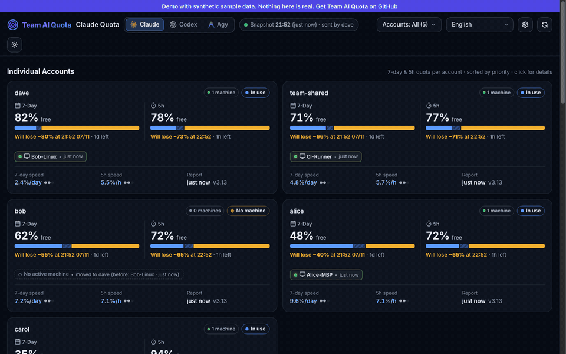
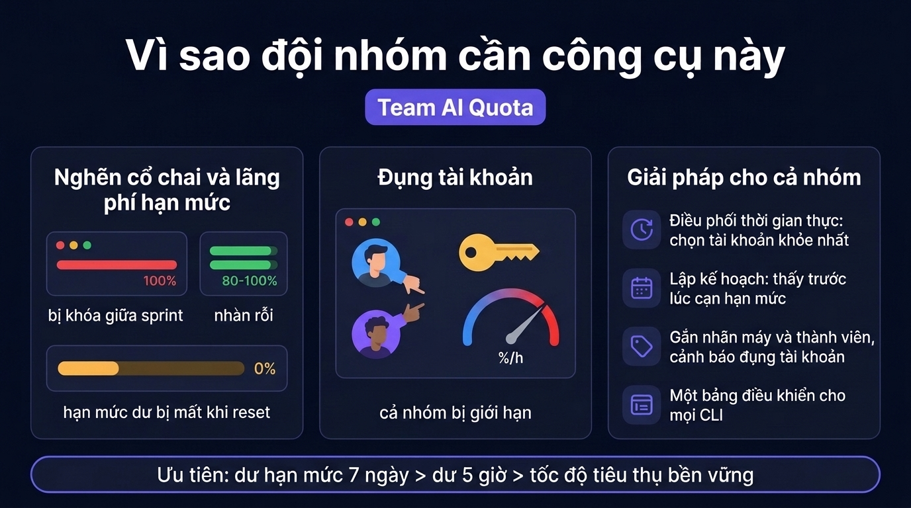
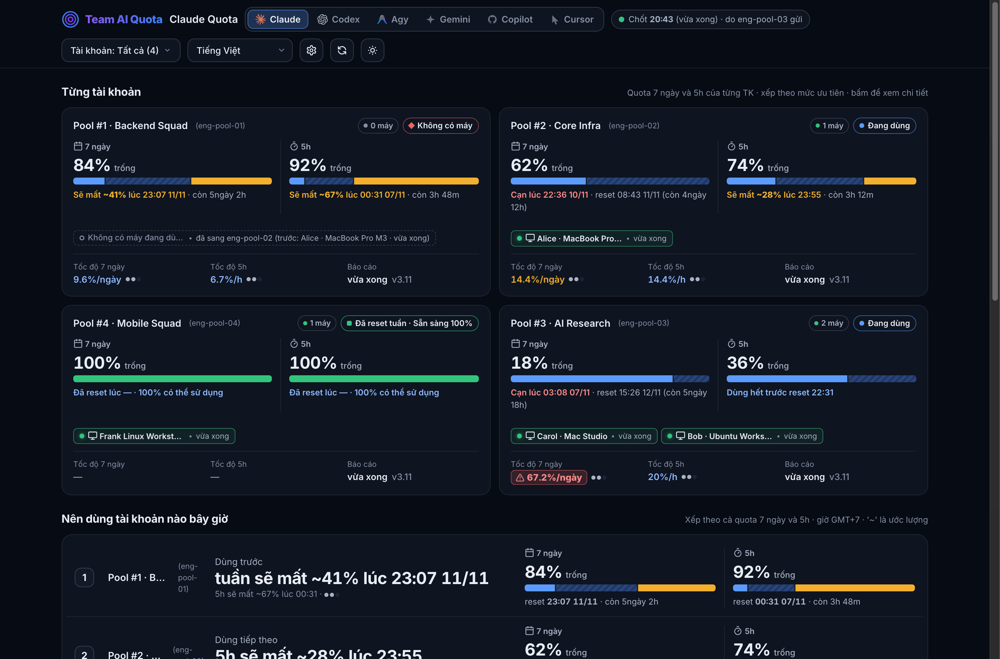
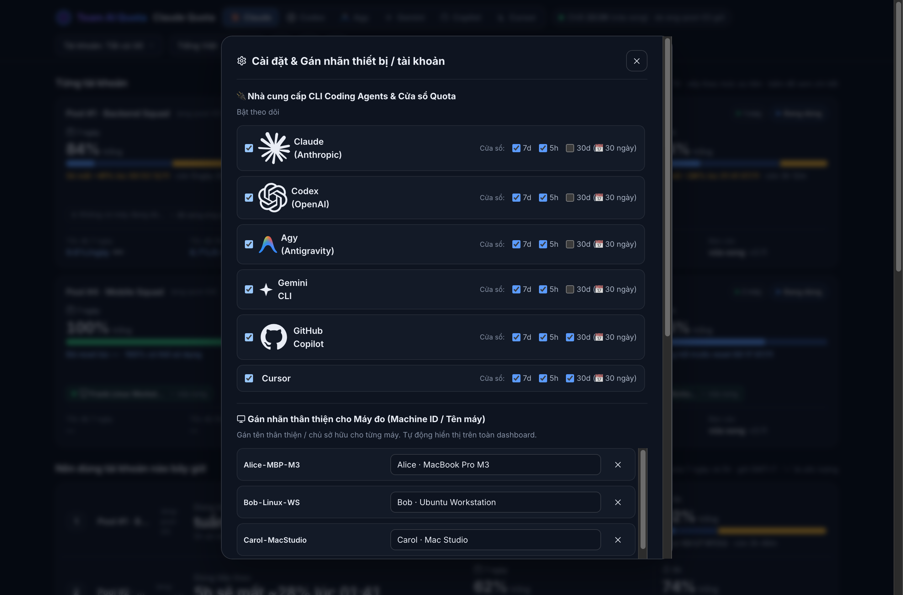
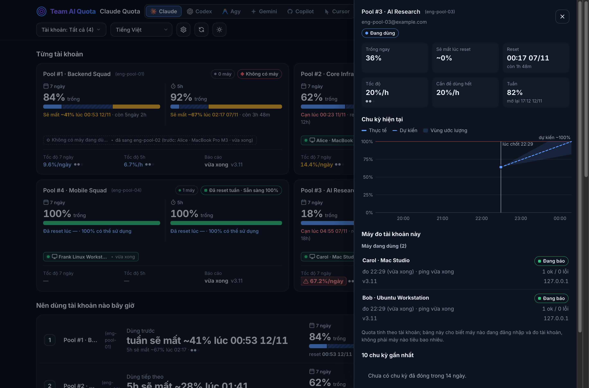
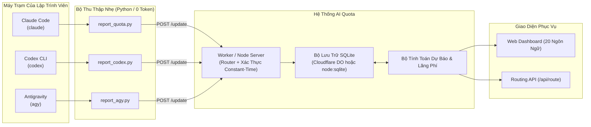

# Team AI Quota

[](https://github.com/braitoli/team-ai-quota/actions/workflows/ci.yml)
[](https://github.com/braitoli/team-ai-quota/pkgs/container/team-ai-quota)
[](LICENSE)
[](https://github.com/braitoli/team-ai-quota/releases/tag/v1.0.0)

> 🇬🇧 [Read in English](README.md) · 🎬 **[Demo trực tiếp (dữ liệu mẫu)](https://braitoli.github.io/team-ai-quota/)**

> Quản lý, điều phối & lập kế hoạch hạn mức AI coding thông minh cho đội nhóm kỹ thuật.

[](https://braitoli.github.io/team-ai-quota/)

**AI Quota Monitor** là nền tảng quản trị hạn mức tập trung, điều phối tải theo thời gian thực và lập kế hoạch sử dụng (capacity planning) được thiết kế chuyên biệt cho đội ngũ kỹ thuật và doanh nghiệp vận hành **CLI Coding Agents** (`Claude Code`, `OpenAI Codex CLI`, `Antigravity`, `Gemini CLI`, `GitHub Copilot CLI`, `Cursor Agent CLI`).

Mặc dù người dùng cá nhân (solo power users) sở hữu nhiều tài khoản vẫn có thể tận dụng rất tốt, hệ thống được thiết kế từ gốc để giải quyết bài toán vận hành cốt lõi của **các squad kỹ thuật (5–50+ lập trình viên)** cùng chia sẻ, luân chuyển và tối ưu hóa nhóm tài nguyên đăng ký AI cao cấp.

---

## Tại sao Đội ngũ & Doanh nghiệp Cần Giải Pháp Này?




Các công cụ theo dõi hạn mức cá nhân hay thanh trạng thái cục bộ chỉ hiển thị thông tin cho một lập trình viên trên một máy trạm duy nhất. Nhưng trong một tổ chức kỹ thuật quản lý một nhóm tài khoản AI (Claude Max/Pro, Codex, Copilot, Cursor, Gemini), các kỹ sư trưởng và quản lý đối mặt với ba bế tắc mang tính cấu trúc:

### 1. Bế Tắc Lệch Tải: Thiếu Cục Bộ & Thừa Lãng Phí
* **Khoá Cứng Giữa Sprint (Thiếu Cục Bộ / Bottlenecks)**: Các kỹ sư lập trình năng suất cao chạm trần hạn mức trượt 5 giờ hoặc hạn mức tuần 7 ngày ngay trong thời điểm nước rút trước đợt phát hành. Tiến độ công việc bị đình trệ hoàn toàn trong khi các gói đăng ký khác của team được cấp cho thành viên khác đang bỏ trống ở mức 80–100%.
* **Chi Phí Chìm & Hết Hạn Lãng Phí (Wasted Capacity)**: Vào cuối mỗi chu kỳ 7 ngày hoặc 30 ngày, hàng loạt tài khoản chưa khai thác hết tự động reset về 0 dù còn dư 60–90% hạn mức—gây lãng phí hàng nghìn USD chi phí đăng ký doanh nghiệp mỗi tháng.
* **Xung Đột Máy Trạm (Seat Collisions)**: Hai hoặc nhiều kỹ sư vô tình cùng đăng nhập làm việc trên cùng một tài khoản, khiến tốc độ đốt quota (`%/h`) tăng vọt theo cấp số nhân và dẫn đến khoá tài khoản chỉ sau vài chục phút.

### 2. Giải Pháp Toàn Diện Cho Doanh Nghiệp: Điều Phối, Quản Trị & Tối Ưu ROI
* **Điều Phối Tải Thông Minh Theo Thời Gian Thực ("Nên dùng tài khoản nào bây giờ?")**: Thuật toán chấm điểm ưu tiên đa yếu tố (`Hạn Mức Còn Trống 7 Ngày > Hạn Mức 5 Giờ > Tốc Độ Đốt Bền Vững`) chỉ định ngay tài khoản tối ưu nhất cho lập trình viên tiếp theo hoặc tác vụ CI tự động qua Web UI, `GET /api/route`, hoặc `ai_quota.py pick`.
* **Kế Hoạch Khai Thác Dự Báo (Predictive Capacity Planning)**: Theo dõi tốc độ tiêu hao thực tế (`%/h`) so với ngưỡng an toàn bền vững (`0.6%/h` cho 7 ngày, `20%/h` cho 5 giờ). Phát hiện sớm nguy cơ chạm trần (`Projected Exhaustion`) trước khi bị khoá và cảnh báo dung lượng dư thừa sắp hết hạn—giúp ban lãnh đạo có số liệu định lượng chính xác để quyết định mua thêm hay cắt giảm số lượng gói cước.
* **Quản Trị Thiết Bị & Thành Viên (Gán Nhãn, Phát Hiện Xung Đột & Handoff)**: Gán nhãn thành viên và máy trạm trực tiếp trên Web UI (`⚙️`), phát hiện xung đột khi nhiều máy cùng dùng 1 tài khoản, theo dõi lịch sử chuyển giao máy trạm (`handoff`), và tự động chuyển tài khoản ngoại tuyến sang trạng thái **`Sẵn sàng 100%`** ngay khi vượt qua mốc reset tuần.
* **Quản Trị Tập Trung Đa CLI Coding Agent**: Chuẩn hoá việc giám sát hạn mức trên toàn bộ hệ sinh thái công cụ lập trình AI không đồng nhất (`Claude Code`, `Codex`, `Antigravity`, `Gemini`, `Copilot`, `Cursor`) trên một bảng điều khiển duy nhất.

---

## Giao Diện Vận Hành Thực Tế & Bảng Điều Khiển Đội Ngũ


*Hình 1: Toàn cảnh Web Dashboard với Thẻ Gợi Ý Trung Tâm ("Nên dùng tài khoản nào bây giờ"), theo dõi đa chu kỳ (7 ngày & 5 giờ) và các trạng thái tài khoản cốt lõi (Sẵn sàng, Đang dùng, Xung đột & Đốt nóng, Đã reset tuần 100%).*

<br/>


*Hình 2: Hộp thoại Cài đặt & Gán nhãn (`⚙️`) hỗ trợ bật/tắt 6 CLI Coding Agents (`claude`, `codex`, `agy`, `gemini`, `copilot`, `cursor`), cấu hình cửa sổ đo (`7d`, `5h`, `30d`), chế độ ưu tiên định tuyến và tên thân thiện cho máy trạm / tài khoản.*

<br/>


*Hình 3: Ngăn chi tiết tài khoản — đường cong tốc độ tiêu thụ kèm dự báo cạn, cảnh báo nhiều người dùng chung một tài khoản và danh sách máy đang đăng nhập, đo tài khoản.*

Dashboard cũng có bản tiếng Anh (bộ chọn ngôn ngữ ở đầu trang): xem [README.md](README.md).

---

## Tính Năng Nổi Bật

### 1. Điều Phối Tải Thông Minh Theo Thời Gian Thực (`GET /api/route`)
- **Định tuyến tài khoản thông minh**: Điều hướng lập trình viên và quy trình tự động đến tài khoản tối ưu nhất tại thời điểm thực tế:
  ```bash
  curl -s -H "x-api-key: <ACCESS_KEY>" "https://quota.example.com/api/route?provider=claude"
  ```
- **Lệnh CLI tiện ích (`ai_quota.py pick`)**: Tích hợp trực tiếp vào shell profile của kỹ sư để tự động mở phiên làm việc với tài khoản có độ ưu tiên cao nhất.
- **Thuật toán trọng số chống nghẽn**: Tính điểm ưu tiên theo công thức `0.45 * Hạn mức tuần còn trống + 0.35 * Hạn mức 5h còn trống + 0.20 * Độ mới/Tốc độ đốt` để ngăn chặn rủi ro cạn hạn mức đột ngột.

### 2. Ưu Tiên Chu Kỳ 7 Ngày (7-Day First Priority) & Giám Sát Đa Cửa Sổ (2 / 3 Chu Kỳ)
- **Ưu tiên hạn mức tuần 7 ngày**: Đặt cột hạn mức 7 ngày ở vị trí ưu tiên bên trái nhằm bảo vệ tốc độ phát triển xuyên suốt tuần làm việc.
- **Theo dõi đồng thời 2 và 3 cửa sổ**: Giám sát song song chu kỳ trượt 5 giờ, chu kỳ trượt 7 ngày và chu kỳ thanh toán tháng 30 ngày (cho Copilot / Cursor).
- **Cảnh báo tốc độ đốt & Hiệu ứng nhịp thở (Breathing Pulse)**: Hiệu ứng trực quan (`rate-pulse`) lập tức cảnh báo khi tốc độ dùng vượt ngưỡng an toàn.

### 3. Lập Kế Hoạch Khai Thác & Dự Báo Tốc Độ Đốt (Capacity Planning & Burn-Rate)
- **Ngưỡng tốc độ bền vững**: Đo lường tốc độ tiêu thụ thực tế so với giới hạn an toàn (`0.6%/h` cho chu kỳ 7 ngày, `20%/h` cho chu kỳ 5 giờ).
- **Dự báo chạm trần (`Projected Exhaustion`)**: Ước tính chính xác thời điểm tài khoản sẽ hết hạn mức dựa trên vận tốc làm việc hiện tại.
- **Phân tích cơ hội lãng phí (`Wasted Capacity`)**: Liệt kê các tài khoản sắp reset nhưng còn tồn dư nhiều hạn mức để kịp thời phân bổ công việc trước khi bị huỷ.

### 4. Quản Trị Thiết Bị & Thành Viên (Gán Nhãn, Xung Đột & Handoff)
- **Tên gợi nhớ thân thiện**: Ánh xạ ID máy (`a1b2c3` → `Dev-MacBook-M3`) và email tài khoản (`acc1@example.com` → `Frontend Seat 1`) trên toàn bộ giao diện dashboard.
- **Phát hiện xung đột tài khoản (Seat Collision)**: Cảnh báo ngay lập tức khi nhiều máy trạm cùng đẩy tải lên một tài khoản.
- **Lịch sử chuyển giao máy trạm (Handoff Tracking)**: Lưu vết quá trình luân chuyển máy và người dùng giữa các ca làm việc.
- **Tự động chuyển `Sẵn sàng 100%`**: Tự động kích hoạt trạng thái khoẻ mạnh 100% cho tài khoản ngoại tuyến ngay khi vượt qua mốc thời gian reset tuần.
- **Đa dạng phương thức cấu hình**:
  - Hộp thoại cài đặt Web UI (nút `⚙️` trên dashboard).
  - REST API endpoint (`POST /api/labels`).
  - Biến môi trường (`MACHINE_LABELS`, `ACCOUNT_LABELS`).
  - Tham số dòng lệnh client (`--label "Tên Máy"`).

### 5. Hỗ Trợ Toàn Diện Đội Ngũ Đa CLI Coding Agent
- Theo dõi độc lập nhiều công cụ lập trình AI trên từng tab riêng biệt (`claude`, `codex`, `agy`, `gemini`, `copilot`, `cursor`).
- Bật/tắt linh hoạt theo dõi cho từng agent và từng phạm vi chu kỳ.

### 6. Kiến Trúc SQLite Doanh Nghiệp Mọi Nơi (SQLite Everywhere)
- **Serverless Edge**: Cloudflare Workers kết hợp SQLite nhúng trong Durable Objects (`TeamStore`). Mỗi provider có một điều phối viên duy nhất đảm bảo giao dịch ACID tuần tự, không xảy ra race condition.
- **Self-Hosted & Docker**: Node.js 22+ tích hợp sẵn `node:sqlite` ở chế độ WAL cho hạ tầng tự lưu trữ, máy chủ nội bộ hoặc VPC cách ly mạng. Hoàn toàn không cần biên dịch C++.

### 7. Dashboard Đa Ngôn Ngữ (20 Ngôn Ngữ)
- **Tự động nhận diện trình duyệt**: Tự phát hiện ngôn ngữ của người dùng và chuyển đổi giao diện mượt mà.
- **Danh sách ngôn ngữ hỗ trợ**: Tiếng Anh (`en`), Tiếng Việt (`vi`), Tiếng Trung giản thể (`zh-CN`), Tiếng Trung phồn thể (`zh-TW`), Tiếng Tây Ban Nha (`es`), Tiếng Nhật (`ja`), Tiếng Đức (`de`), Tiếng Pháp (`fr`), Tiếng Hàn (`ko`), Tiếng Bồ Đào Nha (`pt`), Tiếng Nga (`ru`), Tiếng Ý (`it`), Tiếng Ả Rập (`ar`), Tiếng Hindi (`hi`), Tiếng Indonesia (`id`), Tiếng Thổ Nhĩ Kỳ (`tr`), Tiếng Ba Lan (`pl`), Tiếng Hà Lan (`nl`), Tiếng Thái (`th`), Tiếng Ukraina (`uk`).
- **Chuyển đổi tức thì**: Đổi ngôn ngữ ngay trên giao diện mà không cần tải lại trang.

---

## Kiến Trúc Hệ Thống



---

## Danh Sách Endpoints

| Phương thức | Endpoint | Mô tả | Xác thực |
|---|---|---|---|
| `GET` | `/` hoặc `/dashboard` | Dashboard giao diện web (SSR) nhúng sẵn snapshot | `?key=`, header hoặc localStorage |
| `GET` | `/api/status` (hoặc `/status`) | Snapshot JSON đã tính sẵn (hỗ trợ `ETag` + `304`) | `x-api-key`, `?key=`, Bearer |
| `GET` | `/api/route` | Lấy tài khoản tối ưu cho luân chuyển tự động | `x-api-key`, `?key=`, Bearer |
| `POST` | `/api/update` (hoặc `/update`) | Daemon client đẩy số liệu hạn mức hoặc báo lỗi token | `x-api-key`, `?key=`, Bearer |
| `POST` | `/api/labels` | Cập nhật tên nhãn gợi nhớ cho máy trạm và tài khoản | `x-api-key`, `?key=`, Bearer |
| `GET` | `/health` | Kiểm tra trạng thái hoạt động của server | Không yêu cầu |

Xem chi tiết cấu trúc payload JSON và tài liệu API tại [docs/api.md](docs/api.md).

---

## Khởi Động Nhanh (Phát Triển Cục Bộ)

### 1. Yêu Cầu Môi Trường
- **Node.js**: `v22.0.0` trở lên
- **npm**: `v10.0.0` trở lên
- **Python**: `3.9+` (phục vụ bộ test của client)

### 2. Thiết Lập & Khởi Chạy
```bash
# Clone mã nguồn
git clone https://github.com/braitoli/team-ai-quota.git
cd team-ai-quota

# Thiết lập biến môi trường phát triển cục bộ (.dev.vars được git bỏ qua)
printf "API_SECRET_KEY=local-test-key\nDEV_SEED=1\n" > .dev.vars

# Cài đặt thư viện và chạy kiểm thử
npm install
npm test

# Khởi chạy server nội bộ (giả lập Cloudflare tại cổng 8799)
npm run dev
```

### 3. Nạp Dữ Liệu Thử Nghiệm Thực Tế
Mở một cửa sổ dòng lệnh khác và nạp dữ liệu hoạt động 14 ngày của nhiều tài khoản:
```bash
npm run seed:local
```

Mở trình duyệt truy cập `http://127.0.0.1:8799/?key=local-test-key` để trải nghiệm dashboard tương tác.

---

## Cài Đặt Client Daemon Trên Máy Trạm

Cài đặt background daemon (tiêu tốn 0 token) trên máy tính của lập trình viên để tự động gửi thông số hạn mức:

### macOS (`launchd`)
```bash
curl -fsSL https://raw.githubusercontent.com/braitoli/team-ai-quota/main/scripts/setup-mac.sh | bash -s -- \
  --worker-url "https://quota.example.com" \
  --api-key "your-secret-key"
```

### Linux (`cron` / `systemd`)
```bash
curl -fsSL https://raw.githubusercontent.com/braitoli/team-ai-quota/main/scripts/setup-linux.sh | bash -s -- \
  --worker-url "https://quota.example.com" \
  --api-key "your-secret-key"
```

### Windows (`Task Scheduler`)
```powershell
irm https://raw.githubusercontent.com/braitoli/team-ai-quota/main/scripts/setup-windows.ps1 | iex
```

*Đặc tính của Client Daemon:*
- **Tiêu tốn 0 API token**: Truy vấn trạng thái CLI cục bộ (`claude -p "/usage"`, `codex app-server`), hoàn toàn **không tốn token trả phí**.
- **Không truy cập trái phép credential**: Tuyệt đối không đọc token OAuth, session file hay keychain hệ thống.
- **Giãn cách thông minh (Adaptive Staggering)**: Tự động phân bổ thời điểm gửi thông số tránh xung đột (ví dụ phút 0/15/30/45 cho Claude, phút 3/18/33/48 cho Codex).

---

## Tài Liệu Tham Khảo

- [Hướng Dẫn Triển Khai & Kiến Trúc SQLite](docs/deployment.md)
- [Chi Tiết Đặc Tả REST API & Định Dạng JSON](docs/api.md)
- [Hướng Dẫn Cài Đặt Client Cho macOS](docs/setup-mac.md)
- [Hướng Dẫn Cài Đặt Client Cho Linux](docs/setup-linux.md)
- [Hướng Dẫn Cài Đặt Client Cho Windows](docs/setup-windows.md)

---

## Đóng Góp Cộng Đồng

Dự án luôn chào đón mọi đóng góp! Vui lòng tham khảo [CONTRIBUTING.md](CONTRIBUTING.md) để nắm rõ quy chuẩn viết mã và quy trình tạo pull request.

Nếu có vấn đề liên quan đến bảo mật, xin tham khảo [SECURITY.md](SECURITY.md).

---

## Giấy Phép

Dự án được phân phối dưới giấy phép nguồn mở [MIT License](LICENSE).
