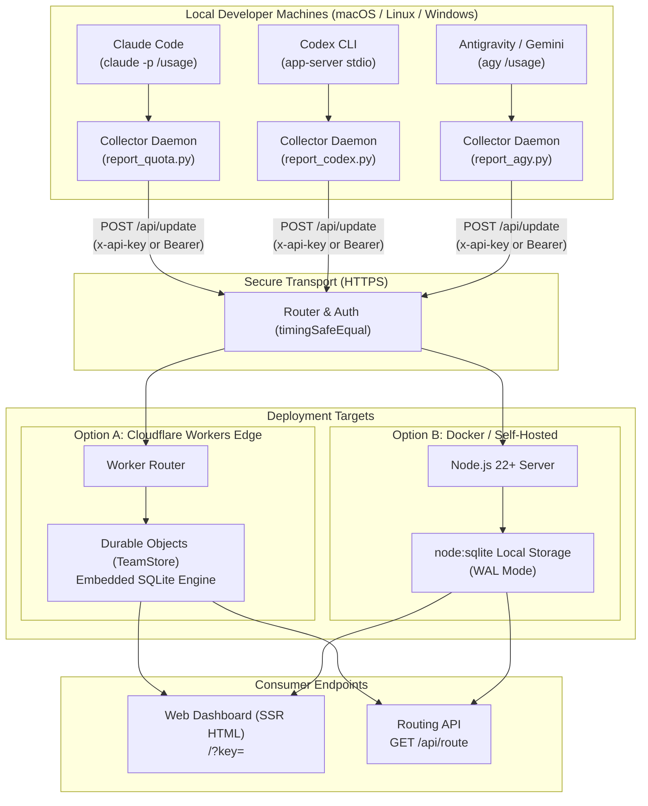

# AI Quota Monitor - Deployment & Architecture Guide

This guide covers deployment options, SQLite storage architecture, daemon collector configurations across operating systems, and safe dual-repo workflows for open-source maintenance.

---

## Architecture Overview

AI Quota Monitor provides unified quota tracking, burn-rate predictions, and intelligent account rotation for modern CLI coding agents (`Claude Code`, `OpenAI Codex CLI`, `Antigravity`, `Gemini CLI`, `GitHub Copilot CLI`, `Cursor Agent CLI`).



---

## Deployment Option 1: Cloudflare Workers + Durable Objects (Serverless Edge)

Cloudflare Workers with SQLite-backed Durable Objects is the recommended deployment method for distributed teams. It offers zero-maintenance transactional persistence, global edge routing, and runs comfortably within the Cloudflare Free Tier.

### 1. Prerequisites
- [Node.js](https://nodejs.org/) v22+
- A Cloudflare account
- Cloudflare CLI (`wrangler` or `cf` CLI)

### 2. Configure Wrangler
Inspect or update `wrangler.jsonc`:

```jsonc
{
  "$schema": "node_modules/wrangler/config-schema.json",
  "name": "ai-quota-monitor",
  "main": "src/index.js",
  "compatibility_date": "2026-10-27",
  "durable_objects": {
    "bindings": [
      {
        "name": "TEAM_STORE",
        "class_name": "TeamStore"
      }
    ]
  },
  "migrations": [
    {
      "tag": "v1",
      "new_sqlite_classes": ["TeamStore"]
    }
  ],
  "observability": {
    "enabled": true
  }
}
```

### 3. Set the Secret Access Key
Generate a strong random secret key and set it via Wrangler:

```bash
# Generate a secure 32-character hex secret
openssl rand -hex 16

# Upload secret to Cloudflare
npx wrangler secret put API_SECRET_KEY
```

### 4. Deploy
```bash
npx wrangler deploy
```

Upon completion, Wrangler will output your live URL:
`https://ai-quota-monitor.<your-subdomain>.workers.dev`

### 5. Attach a Custom Domain (Optional)
Using the Cloudflare CLI or Wrangler:
```bash
# Add custom domain route
npx wrangler routes add "quota.example.com/*" --zone-name "example.com"
```

---

## Deployment Option 2: Docker & Docker Compose (Self-Hosted)

For teams requiring on-premise hosting, air-gapped VPCs, or sovereign data storage, AI Quota Monitor runs natively on Node.js 22 using built-in `node:sqlite`.

### 1. `Dockerfile`
Create a lightweight container image based on `node:22-alpine`:

```dockerfile
FROM node:22-alpine

WORKDIR /app

# Install production dependencies
COPY package*.json ./
RUN npm ci --omit=dev

# Copy application code
COPY src/ ./src/
COPY wrangler.jsonc ./

# Create persistent data volume for SQLite
RUN mkdir -p /data && chown -R node:node /data
VOLUME ["/data"]

ENV NODE_ENV=production
ENV PORT=8799
ENV DATA_DIR=/data

USER node

EXPOSE 8799

CMD ["node", "src/index.js"]
```

### 2. `docker-compose.yml`
```yaml
version: "3.8"

services:
  ai-quota-monitor:
    build: .
    container_name: ai-quota-monitor
    restart: unless-stopped
    ports:
      - "8799:8799"
    environment:
      - API_SECRET_KEY=replace-with-your-secure-secret-key
      - PORT=8799
      - DATA_DIR=/data
    volumes:
      - quota_data:/data

volumes:
  quota_data:
    driver: local
```

### 3. Launching
```bash
docker compose up -d
docker compose logs -f
```

---

## Deployment Option 3: Bare-Metal Node.js 22+ with `systemd`

For dedicated virtual machines (Debian/Ubuntu/RHEL) without Docker:

### 1. Installation
```bash
cd /opt
sudo git clone https://github.com/example-org/ai-quota-monitor.git
cd ai-quota-monitor
sudo npm install --omit=dev
```

### 2. Configure Systemd Service
Create `/etc/systemd/system/ai-quota-monitor.service`:

```ini
[Unit]
Description=AI Quota Monitor Service
After=network.target

[Service]
Type=simple
User=www-data
WorkingDirectory=/opt/ai-quota-monitor
Environment=NODE_ENV=production
Environment=PORT=8799
Environment=API_SECRET_KEY=replace-with-your-secure-secret-key
Environment=DATA_DIR=/var/lib/ai-quota-monitor
ExecStart=/usr/bin/node src/index.js
Restart=always
RestartSec=5

# Hardening
ProtectSystem=strict
ReadWritePaths=/var/lib/ai-quota-monitor
PrivateTmp=true

[Install]
WantedBy=multi-user.target
```

### 3. Enable and Start
```bash
sudo mkdir -p /var/lib/ai-quota-monitor
sudo chown -R www-data:www-data /var/lib/ai-quota-monitor
sudo systemctl daemon-reload
sudo systemctl enable --now ai-quota-monitor
```

---

## Deep Dive: SQLite Architecture

AI Quota Monitor adopts **SQLite everywhere** across both serverless edge and containerized setups.

### Cloudflare Durable Objects SQLite (Serverless Edge)
- **Single-Writer Coordinator**: In Cloudflare Workers, each provider maps to an isolated Durable Object instance (`idFromName("team")` for Claude Code, `idFromName("codex")` for Codex). This guarantees that writes (`POST /update`) are executed sequentially within ACID transactions without multi-region race conditions.
- **Embedded Zero-Latency Execution**: The SQLite database engine executes within the same memory isolate as the Worker code. Transactions incur sub-millisecond execution times without network roundtrips to an external database server.
- **Free-Tier Sustainability**: Each `POST /update` reads a few hundred rows and writes only a few rows; `GET /status` reads 1 row from pre-computed metadata. This stays orders of magnitude below Cloudflare's Free Tier limit (5 million row reads and 100,000 row writes per day).

### Node.js 22 `node:sqlite` (Self-Hosted / Docker)
- **Zero Native Build Dependencies**: Older Node.js SQLite libraries required `node-gyp` and Python C++ compilation on install. AI Quota Monitor utilizes the native `node:sqlite` module shipped with Node.js 22+, eliminating compilation errors across different CPU architectures (ARM64 / x86_64).
- **WAL Mode (Write-Ahead Logging)**: Configured with `PRAGMA journal_mode = WAL;` and `PRAGMA synchronous = NORMAL;`, allowing concurrent read requests to proceed uninterrupted while batch transactions write to disk.

---

## Client Collectors Setup

Client daemons run silently in the background on developer workstations, introspecting local CLI tools and pushing usage telemetry every 15 minutes.

### Supported CLI Coding Agents

| CLI Tool | Detection Path | Method | API Quota Burn |
|---|---|---|---|
| **Claude Code** | `which claude` | `claude -p "/usage"` regex parser | **0 Tokens** |
| **OpenAI Codex CLI** | `which codex` | `codex app-server` stdio JSON-RPC | **0 Tokens** |
| **Antigravity CLI** | `which agy` | `agy /usage` JSON output | **0 Tokens** |
| **Gemini CLI** | `which gemini` | Local config & telemetry | **0 Tokens** |

### Automated Installation Scripts

The repository includes cross-platform setup scripts that automatically detect installed CLIs and schedule non-overlapping background jobs:

#### 1. macOS (`launchd`)
```bash
curl -fsSL https://raw.githubusercontent.com/example-org/ai-quota-monitor/main/scripts/setup-mac.sh | bash -s -- \
  --worker-url "https://quota.example.com" \
  --api-key "your-secret-key"
```
Installs launchd agents in `~/Library/LaunchAgents/` with staggered execution intervals:
- Claude Code daemon: minutes `00, 15, 30, 45`
- Codex daemon: minutes `03, 18, 33, 48`
- Antigravity daemon: minutes `07, 22, 37, 52`

#### 2. Linux (`cron` / `systemd`)
```bash
curl -fsSL https://raw.githubusercontent.com/example-org/ai-quota-monitor/main/scripts/setup-linux.sh | bash -s -- \
  --worker-url "https://quota.example.com" \
  --api-key "your-secret-key"
```

#### 3. Windows (`Task Scheduler`)
In an elevated PowerShell prompt:
```powershell
irm https://raw.githubusercontent.com/example-org/ai-quota-monitor/main/scripts/setup-windows.ps1 | iex
```

### Client Self-Update & Security Safeguards
- **Cryptographic Verification**: Clients verify that update commits from the upstream repository are signed (**Verified**).
- **Graceful Failure**: If network connectivity is lost or rate limits are encountered, clients log the error and continue reporting on their scheduled cadence.
- **Disabling Updates**: To prevent automatic self-updates on a workstation, set:
  ```bash
  export CLAUDE_QUOTA_NO_UPDATE=1
  # or create a marker file:
  touch ~/.claude/quota-monitor/no_update
  ```

---

## Dual-Repo Workflow (Private Internal vs. Public Open-Source)

Organizations maintaining internal enterprise deployments while contributing to the open-source upstream should implement a clean dual-remote strategy.

```
+-----------------------------------+          +-----------------------------------+
|     Internal Operational Repo     |          |       Public Open-Source Repo     |
| (gitlab.internal or private org)  |          | (github.com/example-org/repo)     |
| - Custom deployment pipelines     |          | - Generic @example.com examples   |
| - Internal IP/host configurations |          | - Clean documentation             |
| - Private environment files       |          | - Standard CI workflows           |
+-----------------+-----------------+          +-----------------+-----------------+
                  |                                              ^
                  |         Sanitization & Rebase Sync           |
                  +----------------------------------------------+
```

### 1. Setting Up Dual Remotes
```bash
git remote add origin git@github.internal:team/ai-quota-monitor-private.git
git remote add public git@github.com:example-org/ai-quota-monitor.git
```

### 2. Pre-Push Sanitization Rules
Before pushing commits to the `public` remote, verify:
1. **Zero Secret Leaks**: Run [Gitleaks](https://github.com/gitleaks/gitleaks) or `git-secrets`:
   ```bash
   gitleaks detect --source . --verbose
   ```
2. **Domain & Identity Scrubbing**: Confirm no internal domain names (`@internal-domain.com`) or production IP addresses are included in test fixtures, docs, or code comments:
   ```bash
   git diff public/main..HEAD | grep -iE "@internal-domain|192\.168\.|10\."
   ```
3. **Clean Git History**: Push only squashed or reviewed feature commits to the public remote.
